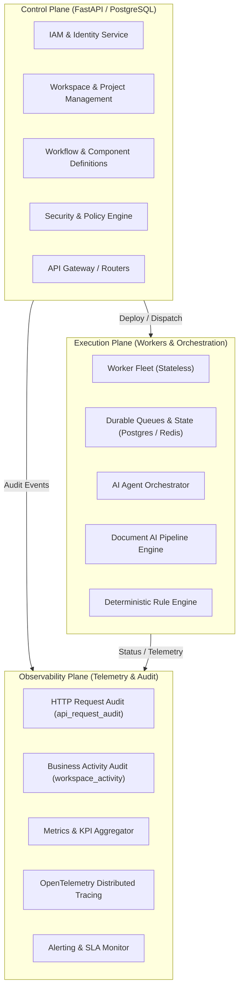
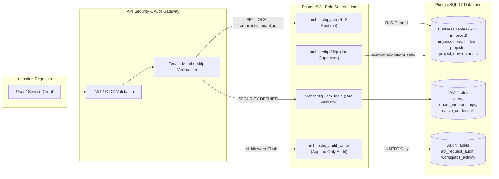
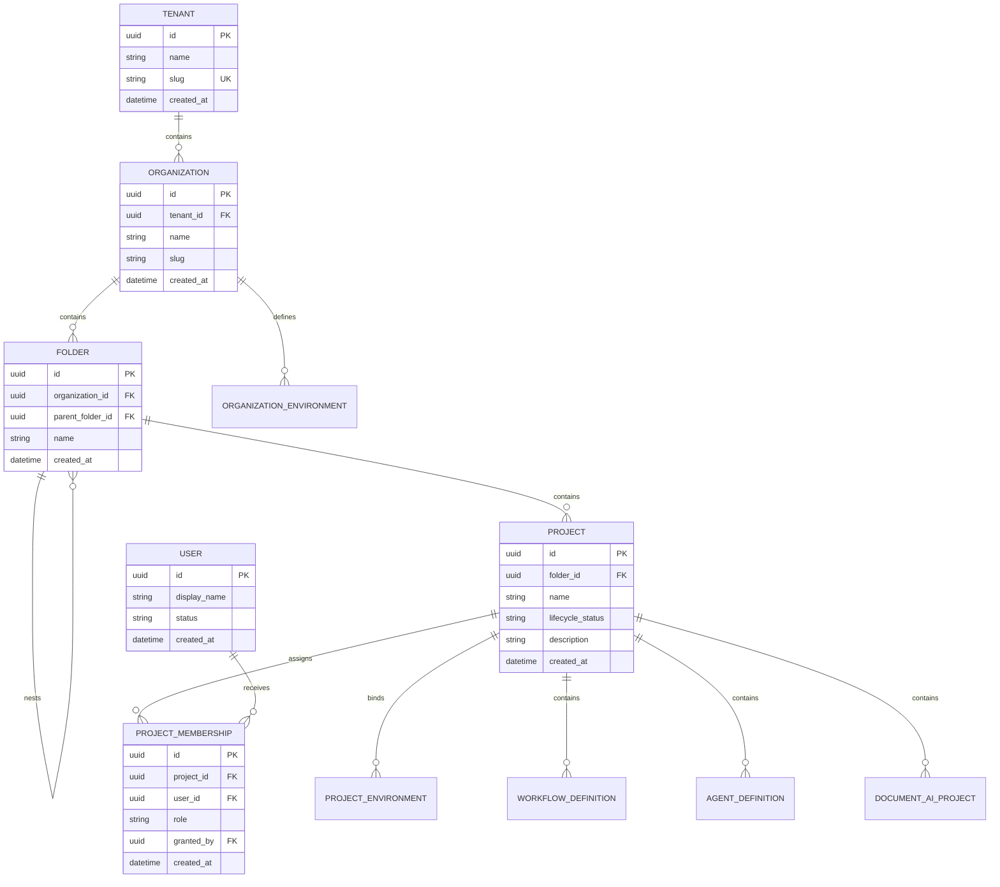
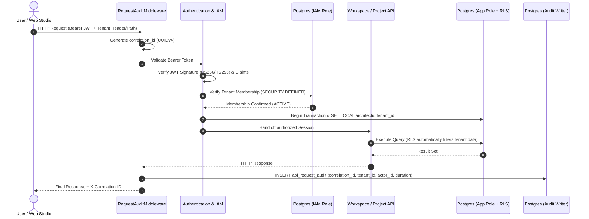

# ArchitectIQ — Target Architecture & System Design

**Date:** 25 October 2026  
**Author:** Antigravity (Principal Architect)  
**System:** ArchitectIQ — Enterprise AI & Automation Studio  
**Foundation Baseline:** FastAPI 0.115+, PostgreSQL 17 (RLS), Redis 7, React 19, Vite 8, TypeScript 5.7  

---

## 1. High-Level Architectural Planes

ArchitectIQ is partitioned into three strictly decoupled architectural planes:

### 1. Control Plane
- **Responsibilities:** Identity authentication (OIDC / Native), tenant isolation, folder and project lifecycle, workflow authoring, model governance, role-based access control, environment promotion approvals.
- **Persistence:** PostgreSQL 17 (System of Record with RLS).
- **Security Boundary:** Least-privilege database roles, transaction-scoped tenant context (`architectiq.tenant_id`), immutable audit logs.

### 2. Execution Plane
- **Responsibilities:** Reliable, deterministic execution of automation workflows, AI agent tool execution, OCR and document parsing, deterministic business rule evaluation, human approval checkpoints.
- **Persistence:** PostgreSQL for durable execution state, checkpoints, and dead-letter queues; Redis for transient queue leases, distributed locks, and pub/sub.
- **Principles:** Worker idempotency, durable waits surviving process restarts, compensating transactions, safe timeouts.

### 3. Observability Plane
- **Responsibilities:** Ingestion and visualization of API request audits, business entity activity logs, worker health heartbeats, SLA attainment metrics, token usage, and LLM inference cost tracking.
- **Integrations:** OpenTelemetry, ECharts dashboards, enterprise SIEM export.

---

## 2. Security Boundaries & PostgreSQL Role Isolation

ArchitectIQ eliminates cross-tenant data leakage by enforcing database-level Row-Level Security (RLS) combined with four distinct PostgreSQL roles:

### Security Boundary Guarantees
1. **No RLS Bypass in App:** The application runtime uses `architectiq_app`, which cannot bypass RLS under any circumstances.
2. **Deterministic Context Setting:** Every database transaction opened for a tenant request sets `architectiq.tenant_id` via `SET LOCAL`. If omitted, RLS policies return **zero rows**.
3. **IAM Partitioning:** Membership verification is handled via `SECURITY DEFINER` routines (`architectiq_verify_tenant_membership`) accessed only by `architectiq_iam_login`.
4. **Append-Only Auditing:** The `architectiq_audit_writer` role possesses `INSERT` grants on `api_request_audit`, preventing tampering or reading of audit records.

---

## 3. Domain Boundaries & Canonical Data Model

### Hierarchy Invariants:
1. `Tenant → Organization → Folder(s) → Project → Project Components`
2. **Cycle Prevention:** Folders cannot be made parents of their own ancestors. Enforced via database triggers (`fbe4556e3af8`).
3. **Cross-Organization Boundary:** A folder or project cannot be moved across organization boundaries (`apps/api/workspace.py` and constraints).
4. **Independent Environments:** Organizations define governed environments (`DEV`, `TEST`, `UAT`, `PROD`). Projects bind to these environments with distinct configurations.

---

## 4. End-to-End Request & Data Flow

---

## 5. Deployment & Disaster Recovery

### Local & CI Baseline
- Single-command orchestration via `docker compose -f infrastructure/docker/compose.yaml up -d`.
- Isolated test database (`architectiq_test`) automatically provisioned and validated by `conftest.py`.

### Production Deployment Architecture
- **API Nodes:** Stateless containerized FastAPI instances behind an enterprise Load Balancer / Reverse Proxy.
- **Database:** PostgreSQL Primary with Synchronous Read Replicas; automated WAL archiving; Point-In-Time-Recovery (PITR) target: RPO < 5 minutes, RTO < 30 minutes.
- **Secrets Management:** External Key Management (HashiCorp Vault / CyberArk / AWS Secrets Manager) mapped via environment variables at container initialization; no plaintext secrets in repository or databases.
- **Static Frontend:** Vite production bundle distributed through a Content Delivery Network (CDN) with Content-Security-Policy (CSP) headers.
