# ArchitectIQ — Milestone Delivery Plan & Roadmap

**Date:** 25 October 2026  
**Author:** Antigravity (Delivery Lead & Principal Architect)  
**Baseline Commit:** `b47e7d5` (43 passing API tests)  
**Execution Paradigm:** Small, verifiable slices with automated test verification at every gate. Never claim completion without runnable automated tests.

---

## 1. Sequenced Milestones Overview

```mermaid
flowchart LR
    S0["Stage 0: Recovery & Inventory (COMPLETE)"]
    M4_1["M4.1: Project RBAC & Membership"]
    M4_2["M4.2: Project Lifecycle & Metadata"]
    M4_3["M4.3: Environment Bindings & Promotion"]
    M4_4["M4.4: Enterprise Workspace UX"]
    M4_5["M4.5: M4 Stabilization Gate"]
    M5["M5: Workflow Designer & Schema"]
    M6["M6: Durable Execution Engine"]
    M7["M7: Approvals & Rules Engine"]
    M8["M8: AI Agent & Model Gateway"]
    M9["M9: Document AI Lifecycle"]
    M10["M10: Integrations & Marketplace"]
    M11["M11: Observability & Support"]
    M12["M12: Enterprise Hardening & Release"]

    S0 --> M4_1 --> M4_2 --> M4_3 --> M4_4 --> M4_5
    M4_5 --> M5 --> M6 --> M7 --> M8 --> M9 --> M10 --> M11 --> M12
```

---

## 2. Detailed Milestone Breakdown

### Stage 0: Recovery, Baseline Verification & Truthful Inventory (Completed)
- **Scope:** Repository inventory, verification of 43 API tests against `architectiq_test`, frontend build & lint, untracked artifacts evaluation, failed Claude patch isolation, and documentation.
- **Gate:** 6 mandatory handoff reports created; zero code regressions; uncommitted diff in `workspace.py` isolated.

---

### Milestone M4: Workspace Management & Project Governance

#### M4.1 — Project Membership and RBAC (Immediate Priority)
- **Deliverables:**
  - Database migration: Create `project_memberships` table (`id`, `project_id`, `user_id`, `role`, `created_at`, `granted_by`).
  - Constraint: Unique `(project_id, user_id)`, allowed roles: `OWNER`, `ADMIN`, `EDITOR`, `VIEWER`.
  - Service: `PermissionService` to compute effective project permissions (inheriting or direct).
  - API Endpoints:
    - `GET /api/v1/tenants/{tenant_id}/projects/{project_id}/members`: List members and assigned roles.
    - `POST /api/v1/tenants/{tenant_id}/projects/{project_id}/members`: Assign or invite member with role.
    - `PATCH /api/v1/tenants/{tenant_id}/projects/{project_id}/members/{user_id}`: Update member role (with last-owner protection).
    - `DELETE /api/v1/tenants/{tenant_id}/projects/{project_id}/members/{user_id}`: Remove member (last-owner prevented).
  - UI Implementation:
    - Replace placeholder in `WorkspaceLive.tsx` Access tab with live member table, role selector dropdown, add member form, and remove confirmation.
  - Test Suite:
    - `test_project_rbac.py`: Role enforcement, cross-tenant assignment rejection, last-owner removal rejection, privilege escalation prevention.
- **Acceptance Gate:** 43 baseline tests + new RBAC test suite pass. Full UI flow demonstrable.

#### M4.2 — Project Lifecycle & Metadata
- **Deliverables:**
  - Migration: Add `lifecycle_status` (`ACTIVE`, `ARCHIVED`, `SUSPENDED`), `description`, `tags`, `owner_id`, `cost_center` to `projects`.
  - API: Archive/restore endpoints, soft-delete with retention policies.
  - UI: Project metadata inspector, status pills, archive confirmation modal.
- **Acceptance Gate:** Lifecycle transitions audited and reversible.

#### M4.3 — Environment Bindings & Promotion Governance
- **Deliverables:**
  - Per-project environment configuration overrides, promotion request and approval records.
  - Drift detection check between `DEV`, `TEST`, `UAT`, and `PROD`.
- **Acceptance Gate:** Cross-environment isolation tests pass; promotion cannot bypass approval.

#### M4.4 — Enterprise Workspace UX
- **Deliverables:**
  - Tree virtualization for high-scale organizations (>1,000 nodes).
  - Context menus (Right-click: New Folder, New Project, Move, Archive).
  - Breadcrumb navigation, favorites, and search filtering in tree.
- **Acceptance Gate:** WCAG 2.2 AA keyboard navigation test pass; zero dead buttons.

#### M4.5 — Milestone M4 Stabilization & Delivery Gate
- **Deliverables:**
  - Complete integration test suite covering entire project lifecycle from creation to archiving and access delegation.
  - Documentation and API contract freeze.
- **Acceptance Gate:** Clean test run across all test files on `architectiq_test`. Tag commit `m4-release-baseline`.

---

### Subsequent Strategic Milestones (M5 – M12)

| Milestone | Scope Summary | Core Deliverables | Dependencies |
|---|---|---|---|
| **M5: Workflow Designer** | Visual orchestration canvas | React Flow visual builder, canonical JSON schema, ELK auto-layout, node inspector, versioning & draft diffs. | M4.5 |
| **M6: Execution & Orchestration** | Durable runtime engine | PostgreSQL state machine, job scheduling, worker pooling, retries, dead-letter queues, idempotent execution. | M5 |
| **M7: Human Approvals & Rules** | Decisioning & governance | Human-in-the-loop task inbox, dual-authorization gates, deterministic rule tables, SOP diff review. | M6 |
| **M8: AI Agent & Model Gateway** | Governed AI studio | Model routing (Azure, Vertex, Anthropic, Ollama), prompt versioning, agent tool registry, token cost budgets. | M7 |
| **M9: Document AI Lifecycle** | Intelligent document processing | Ingestion, page splitting, OCR adapter, annotation UI, field extraction schemas, human validation queue. | M6, M8 |
| **M10: Enterprise Integrations** | Connectors & catalog | REST, GraphQL, DB, SFTP connectors, secret references (CyberArk / Vault), reusable component marketplace. | M5, M8 |
| **M11: Observability & Support** | Operational command center | ECharts telemetry dashboards, structured OpenTelemetry traces, SLA risk monitors, diagnostic runbooks. | M6, M8, M9 |
| **M12: Enterprise Hardening** | Production release | Penetration testing, automated CI/CD pipeline, backup/restore drills, high-availability verification, final docs. | M11 |

---

## 3. Database Migration Strategy

1. **Forward-Only, Additive Schema Changes:**
   - No historical migrations are ever edited after commit.
   - Every migration must provide robust `upgrade()` and clean `downgrade()` routines.
2. **Pre-flight Migration Testing:**
   - Tests execute against `architectiq_test` only.
   - Validated using `validate_test_schema.py` and Alembic offline SQL generation before online execution.
3. **Rollback Procedures:**
   - If an error occurs during migration execution, transaction rollback aborts the operation.
   - Explicit downgrade command: `alembic downgrade -1` targeting `architectiq_test`.

---

## 4. Rollback and Disaster Recovery Runbook

In the event of a critical failure during any milestone implementation:
1. **Source Rollback:** Discard uncommitted changes via `git restore <file>` or revert local commit via `git revert <commit>`.
2. **Database Rollback:** Downgrade the exact migration revision using Alembic. Verify database integrity using `apps/api/check_connections.py` and `validate_test_schema.py`.
3. **Container State:** Docker volumes (`postgres_data`, `redis_data`) remain intact. Never run `docker compose down -v` or prune volumes.
