# ArchitectIQ — Design System, UX Standards & Navigation Architecture

**Date:** 25 October 2026  
**Author:** Antigravity (Principal Architect & UI/UX Lead)  
**Document Standard:** Reconciles the frozen 6 primary workspaces with the authoritative 20-module navigation catalogue (`ArchitectIQ - Enterprise UI Navigat.txt`).

---

## 1. Top-Level Workspace Architecture & 20-Module Reconciliation

ArchitectIQ standardizes on **six frozen top-level workspaces** with independent environment selection and hierarchical breadcrumbs visible across all screens. The 20 functional enterprise modules map directly under these 6 workspaces:

```mermaid
flowchart TD
    subgraph AppShell["ArchitectIQ Global Shell (Tenant, Org, Independent Environment Selector: DEV/TEST/UAT/PROD)"]
        W1["1. Dashboard"]
        W2["2. Configure"]
        W3["3. Test"]
        W4["4. Run"]
        W5["5. Support"]
        W6["6. Master Setup (Admin Only)"]
    end

    W1 --> M01["01. Home & Dashboard (/home)"]
    W1 --> M15["15. Analytics & Reporting (/analytics)"]

    W2 --> M02["02. Workspace & Projects (/workspace)"]
    W2 --> M03["03. Automation Studio (/automation)"]
    W2 --> M04["04. AI Agent Studio (/agents)"]
    W2 --> M05["05. AI & Model Studio (/ai)"]
    W2 --> M06["06. Document Intelligence (/documents)"]
    W2 --> M07["07. Integration & MCP Studio (/integrations)"]
    W2 --> M08["08. Data & Knowledge Studio (/data)"]
    W2 --> M17["17. Collaboration & Assets (/collaboration)"]

    W3 --> M12["12. Testing & Evaluation (/testing)"]

    W4 --> M09["09. Task Center (/tasks)"]
    W4 --> M10["10. Approvals & Exceptions (/approvals)"]
    W4 --> M11["11. Execution & Orchestration (/execution)"]
    W4 --> M13["13. Deployment & Releases (/deployment)"]
    W4 --> M14["14. Operations & Monitoring (/operations)"]

    W5 --> M18["18. Support & Service Management (/support)"]

    W6 --> M16["16. Governance, Risk & Compliance (/governance)"]
    W6 --> M19["19. Settings & Configuration (/settings)"]
    W6 --> M20["20. Platform Administration (/admin)"]
```

---

## 2. Global Shell & Navigation Specifications

### Global Header Components
1. **Tenant Switcher:** Dropdown displaying active tenant name and slug (`/api/v1/me/tenants`). Switching clears active live nodes and re-queries workspace tree.
2. **Organization Context:** Current organization indicator with quick switcher.
3. **Independent Environment Selector:** Persistent pill selector allowing seamless switching between `DEV`, `TEST`, `UAT`, and `PROD` without resetting tree context.
4. **Command Palette (`Ctrl+K`):** Global search dialog offering quick jump across projects, workflows, agents, tasks, and settings.
5. **Notification Bell:** Live alerts for failed jobs, pending approval gates, and SLA risks.
6. **Appearance Studio Trigger:** Quick access to personalization controls.
7. **User Profile & Sign Out:** Displays authenticated actor display name, session status, and revocation button.

---

## 3. UI Component Catalog

### 1. Navigation & Tree Components
- **`TreeItem` / `ResourceTree`:**
  - Recursive tree supporting Organizations, Folders, Projects, and Environments.
  - Interactive expand/collapse chevrons with persistent expansion state.
  - Drag-and-drop handles for moving folders and projects across hierarchy (respecting cyclic and cross-org boundaries).
  - High-density and virtualized list support for organizations with >1,000 items.

### 2. Inspector & Detail Panes
- **Palette → Canvas → Inspector Pattern:**
  - Used in Workflow Designer (`Flow Studio`), Agent Builder, and Document Studio.
  - Tabbed inspector panels: `Overview`, `Activity`, `Access`, `Jobs`, `Triggers`, `Settings`.
- **Activity Console (`AuditEvent` Table):**
  - Displays business mutation events with actor, timestamp, operation (`INSERT`, `UPDATE`, `DELETE`).
  - Interactive JSON diff modal comparing `old_values` versus `new_values`.

### 3. Modals & Drawers
- **Appearance Studio Drawer:**
  - Glassmorphic slide-out drawer controlling theme (`dark`, `light`, `system`), presets (`professional`, `balanced`, `immersive`), accent color (`blue`, `violet`, `cyan`, `emerald`), and glass sliders.
- **Confirmation Modals:**
  - Explicit confirmation for destructive actions (Delete, Archive, Revoke Access) with typing confirmations for critical resources.

---

## 4. Visual Design System & Styling Tokens

The visual foundation is defined in `App.css` using customizable CSS variables:

| Token Name | Default Value (Immersive Dark) | Description |
|---|---|---|
| `--accent` | `#a18aff` (Violet) | Primary brand and focus highlight color |
| `--glass-opacity` | `0.28` (72% transparency) | Background opacity for glassmorphic cards |
| `--glass-blur` | `22px` | Backdrop filter blur radius |
| `--shadow-strength` | `0.72` | Dynamic elevation shadow intensity |
| `--font-sans` | Inter, system-ui, sans-serif | Primary typographic family |
| `--font-mono` | JetBrains Mono, monospace | Code, JSON diffs, and UUID values |

### Theme Modes
- **Dark Mode (Default):** Deep dark tones (`#0e0c18`, `#17142b`) with ambient background glows.
- **Light Mode:** High-contrast crisp enterprise theme (`#f7f8fc`, `#ffffff`) with subtle shadows.
- **System Mode:** Automatically synchronizes with OS prefers-color-scheme media queries.

---

## 5. Interaction & Accessibility Standards (WCAG 2.2 AA)

1. **No Dead Buttons:** Every clickable button, link, or tab must either perform a functional action or display an explicit "PLANNED / COMING SOON" disabled state with helpful explanatory tooltip.
2. **Keyboard Navigation:**
   - Full keyboard accessibility across tree navigation (Arrow keys, Space to toggle, Enter to select).
   - Global shortcuts: `Ctrl+K` for command palette, `Escape` to dismiss overlays, drawers, and search modals.
3. **Screen Reader Support:**
   - Proper `role="tablist"`, `role="tab"`, `aria-selected`, `aria-expanded`, and `aria-label` attributes on all dynamic interactive controls.
4. **Form Validation & Error States:**
   - Real-time inline feedback for invalid slugs, duplicate names, or schema violations before API submission.
   - Non-blocking toast notifications for successful background mutations.
